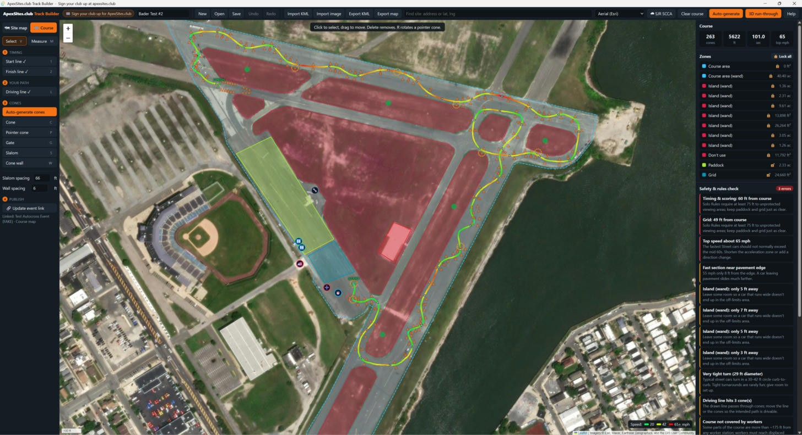

# ApexSites.club Track Builder

**Free autocross course design for Windows, Mac and Linux.** Map the site from aerial photos, design the course, check it against the SCCA Solo safety rules, drive it in 3D, and publish it to your club's website.

Brought to you by **[ApexSites.club](https://apexsites.club/?utm_source=github&utm_medium=readme)**: websites, events, emails and course maps for motorsport clubs.



## Download

No account, no subscription, nothing to build. Download the installer for your computer and open it.

| Your computer | Download |
|---|---|
| **Windows** 10 or 11 | **[TrackBuilder-Windows-Setup.exe](https://github.com/eac-wirings/autocross-course-designer/releases/latest/download/TrackBuilder-Windows-Setup.exe)** |
| **Mac** with Apple chip (M1 or later) | **[TrackBuilder-Mac-AppleSilicon.dmg](https://github.com/eac-wirings/autocross-course-designer/releases/latest/download/TrackBuilder-Mac-AppleSilicon.dmg)** |
| **Mac** with Intel chip | **[TrackBuilder-Mac-Intel.dmg](https://github.com/eac-wirings/autocross-course-designer/releases/latest/download/TrackBuilder-Mac-Intel.dmg)** |
| **Linux** (most distributions) | **[TrackBuilder-Linux.AppImage](https://github.com/eac-wirings/autocross-course-designer/releases/latest/download/TrackBuilder-Linux.AppImage)** or **[.deb](https://github.com/eac-wirings/autocross-course-designer/releases/latest/download/TrackBuilder-Linux.deb)** |

**Windows:** run the file and click **Next** until it finishes. If Windows shows "Windows protected your PC", click **More info**, then **Run anyway**.

**Mac:** open the `.dmg` and drag **Track Builder** into **Applications**. The first time, right-click the app and choose **Open**, then **Open** again, because the app isn't from the App Store. Not sure which chip you have? Click the Apple menu, then **About This Mac**, and look at **Chip** or **Processor**.

**Linux:** for the AppImage, make it executable (`chmod +x TrackBuilder-Linux.AppImage`) and run it. Or install the `.deb` with your package manager.

**Updates are automatic.** When a new version comes out, the app shows a banner. Click **Install and restart**. You can also check any time with **Help → Check for updates**.

Other files and older versions are on the [releases page](https://github.com/eac-wirings/autocross-course-designer/releases).

## Works with your club's ApexSites.club website

Track Builder works on its own. If your club is on **[ApexSites.club](https://apexsites.club/?utm_source=github&utm_medium=readme)**, it can also publish courses for you:

- **Sign in with your club account.** You approve the sign-in in your browser, and the app never sees your password.
- **Link a course to an event.** Pick one of your club's events and the course map appears on the event page of your club website, ready for drivers.
- **Interactive course maps for drivers.** Satellite imagery, zoom, cones that scale, the smooth driving line, and **"Show my location"** so drivers can see where they are while walking the course on event day.
- **QR code and Google Earth file.** Print the QR code for paddock signs, or download the course for Google Earth.
- **Community track maps.** Load a venue another club has already mapped, or share yours. Only the site is shared: course area, off-limits zones and facilities. Your cones and line stay private.

**[Sign your club up for ApexSites.club →](https://apexsites.club/?utm_source=github&utm_medium=readme&utm_campaign=signup)**

## What it does

**Map the site**
- Free aerial imagery, or import a Google Earth screenshot or KML.
- **Find pavement:** click inside a parking lot or runway and the app outlines it for you. Grass islands become off-limits zones automatically.
- Clean up outlines without moving points one at a time: cut away, add area, straighten an edge, smooth edges, and lock finished zones.
- Mark the course area, paddock, grid, spectator and off-limits areas, plus light poles, curbs, obstacles and surface hazards.
- Mark event facilities: timing & scoring, registration, tech, first aid, fire extinguishers, restrooms, impound and emergency access.

**Design the course**
- Place the start and finish, then draw the path you want to drive.
- **Auto-generate cones:** gates, apex pointers, slaloms or offset gates on long straights, the finish chute and a slow-down gate, all kept on usable pavement. It can also design the whole path for you, with or without crossovers.
- Or place cones by hand: standing and pointer cones, gates, slaloms, cone walls.

**Check it**
- A live safety check based on the SCCA Solo Rules and Course Designer training. It covers distances to obstacles (25 ft) and people (75 ft), staying on pavement, top speed and long acceleration zones, slalom spacing and gate width, finish runout and where the finish points, separation between sections, and worker coverage.
- The finish runout is drawn on the map: green where it's clear, red where it falls short, with what cuts it off.
- **3D run-through:** watch the course from the driver's seat, a chase camera or above.

**Share it**
- Save project files, export a map picture or a Google Earth file, or link the course to your club's event on ApexSites.club.

Speeds come from a simple simulation, so treat them as estimates. The checker helps the Event Chair and Safety Steward walk the course; it doesn't replace that walk.

Your work stays on your computer. Nothing is sent anywhere unless you sign in and choose to link a course or share a site.

## For developers

You only need this to change the app yourself. Everyone else, use the downloads above.

You need Node 20 or later and Rust (stable). On Linux you also need the [Tauri system packages](https://v2.tauri.app/start/prerequisites/).

```sh
npm install
npm run app:dev     # run the desktop app in development mode
npm run app:build   # build installers into src-tauri/target/release/bundle
```

## Imagery credits

Esri World Imagery: © Esri, Maxar, Earthstar Geographics, and the GIS User Community. USGS The National Map imagery is in the public domain. Map data © OpenStreetMap contributors. Place search uses OpenStreetMap Nominatim.

## License

MIT. Track Builder is free to use and sponsored by [ApexSites.club](https://apexsites.club/?utm_source=github&utm_medium=readme).
